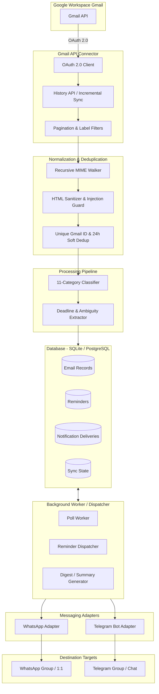

# System Architecture

The Gmail-to-WhatsApp-and-Telegram system continuously monitors Gmail mailboxes, extracts actionable deadlines, normalizes content, and dispatches real-time notifications and reminders.

## Key Architectural Principles

1. **Category Inclusivity:**
   Processes all email categories (Academics, Examinations, Placements, Fees, Meetings, Personal, Bills, Travel, Newsletters, Security alerts, Other). An email is never dropped due to classification failure.

2. **Accurate Date Handling:**
   Distinguishes submission deadlines from general event dates, email timestamps, and ambiguous slash dates. Ambiguous dates are flagged for review rather than inventing false alarms.

3. **Channel Independence:**
   WhatsApp and Telegram adapters operate independently. A temporary rate limit or outage on one platform never blocks delivery on the other.

4. **Idempotency & Deduplication:**
   Every message dispatched is recorded in `NotificationDelivery` with an idempotency key (`{email_id}_{channel}_{destination_id}_{type}`) preventing duplicate sends even during retries or worker restarts.

5. **Security & Privacy:**
   - Tokens are encrypted at rest via symmetric Fernet encryption (`GOOGLE_TOKEN_ENCRYPTION_KEY`).
   - HTML bodies are sanitized, stripping `<script>`, `<iframe>`, and event handlers.
   - Credentials and bot tokens are automatically redacted in structured JSON logs.
   - Privacy mode allows sending notifications with subject, sender, and Gmail link only, without sharing email body contents into group chats.
